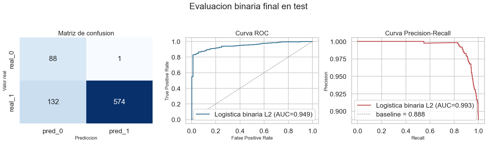

# Clasificación del rendimiento estudiantil con NumPy

Trabajo práctico individual de **I302 — Aprendizaje Automático y Aprendizaje Profundo**,
Universidad de San Andrés, primer semestre de 2026.

**Autor:** Tomás González.

Implementación y comparación de modelos de clasificación para predecir el rendimiento
estudiantil, considerando diferencias entre escuelas, cambios temporales y desbalance de clases.



## Documentación

- [Consigna original](docs/consigna.pdf).
- [Notebook de la entrega](notebook/Entrega_TP2.ipynb): desarrollo, resultados y conclusiones.
- [README original](docs/README_entrega_original.md): organización y declaración
  sobre asistencia de IA en el código de gráficos.

## Contenido

| Ruta | Función |
| --- | --- |
| `src/modelos.py` | Logística binaria y multiclase, LDA, árbol de decisión y Random Forest con entropía. |
| `src/metricas.py` | Matrices de confusión, accuracy, precision, recall, F1, curvas ROC/PR y áreas. |
| `src/validation.py` | Particiones aleatorias, por escuela, temporales y validación cruzada. |
| `src/datos.py`, `src/preprocesamiento.py` | Carga, limpieza, imputación y transformación de variables. |
| `src/experimentos.py` | Entrenamiento, selección de parámetros, rebalanceo y evaluación. |
| `src/analisis_exploratorio.py`, `src/visualizacion.py` | Análisis y gráficos. |
| `src/configuracion.py`, `src/secciones_notebook.py`, `src/utilidades.py` | Configuración y coordinación del flujo del notebook. |
| `data/raw/` | 5.058 registros de desarrollo y 795 de test, suministrados por la cátedra. |
| `data/processed/` | Datos limpios conservados de la entrega. |
| `outputs/tables/` | 13 CSV de búsquedas, validación y curvas de aprendizaje. |

Los datos originales contemplan ocho escuelas y seis semestres. Los CSV incluidos
con la consigna coinciden byte a byte con `data/raw/` y se guardan una sola vez.

## Recorrido del TP

1. Explorar las variables, clases y diferencias entre escuelas y semestres; limpiar los datos.
2. Implementar regresión logística binaria L2 y comparar random split, group split y temporal split.
3. Ajustar regularización y analizar estabilidad de coeficientes entre estrategias de validación.
4. Comparar LDA, logística multiclase y Random Forest con GroupKFold por escuela.
5. Evaluar undersampling, duplicación, SMOTE y ponderación de costos frente a no rebalancear.
6. Seleccionar los modelos finales, reentrenar sobre desarrollo y evaluar en test.
7. Estimar con una curva de aprendizaje los datos adicionales necesarios para mejorar el Random Forest.

Los modelos se implementan con NumPy, sin scikit-learn. Pandas maneja las tablas
y Matplotlib/Seaborn los gráficos. El rebalanceo se aplica al entrenamiento de cada fold.

## Resultados originales guardados

Para el caso binario se elige logística L2 con ponderación de costos; para el
multiclase, logística multiclase evaluada mediante GroupKFold por escuela.
La tabla de evaluación final de test guardada en el notebook reporta:

| Resultado | Valor |
| --- | ---: |
| Accuracy binaria | 0,833 |
| F1 binario, clase positiva «Aprobado» | 0,896 |
| Recall para «Insuficiente» | 0,989 |
| Casos «Insuficiente» detectados | 88 de 89 |
| Aprobados señalados como «Insuficiente» | 132 |
| Accuracy multiclase | 0,692 |
| Macro F1 multiclase | 0,654 |

La distinción de clases importa: las métricas binarias generales toman «Aprobado»
como positivo; las métricas de riesgo se calculan para «Insuficiente».
Los valores anteriores proceden de las salidas originales y no de un nuevo entrenamiento.

El análisis original de la curva de aprendizaje del Random Forest estima unos
**9.118 registros adicionales** para aumentar accuracy de aproximadamente 0,571
a 0,581. Es una extrapolación del ajuste utilizado en el TP, no una garantía.

## Ejecutar

El notebook registra **Python 3.12.2**. Las versiones originales de las bibliotecas
no quedaron registradas. Se requiere **NumPy 2.0 o posterior** porque `metricas.py`
utiliza `np.trapezoid`; las dependencias están en `requirements.txt`.

Desde la raíz del repositorio:

```sh
python -m venv .venv
```

Activar el entorno:

```powershell
# Windows PowerShell
.\.venv\Scripts\Activate.ps1
```

```sh
# macOS / Linux
source .venv/bin/activate
```

Instalar las dependencias y abrir el notebook:

```sh
python -m pip install -r requirements.txt
cd notebook
python -m jupyterlab
```

Abrir `Entrega_TP2.ipynb`, seleccionar el entorno y ejecutar las celdas en orden.
El directorio de trabajo debe ser `notebook/` o la raíz del proyecto, según el
mecanismo de resolución de rutas del notebook original.

El flujo puede tardar por la validación cruzada, las grillas y los Random Forest.
La ejecución guarda datos procesados, tablas y figuras en las carpetas del proyecto;
conviene usar una copia o rama si se desean comparar con los archivos entregados.
Las salidas guardadas permiten recorrer los resultados sin volver a entrenar.

## Conservación y verificación

Se preservaron sin modificaciones los 30 archivos de la entrega y se agregó la
consigna. La figura del README se extrajo de una salida guardada del notebook.
Se añadieron instrucciones, dependencias y un
[registro de procedencia con hashes SHA-256](docs/procedencia.json).

Se verificaron sintaxis, correspondencia de los datos con la consigna y comprobaciones
acotadas de los cuatro modelos principales con datos sintéticos. También se comprobó
la separación de escuelas entre train y validation en GroupKFold, la cobertura de
los folds y métricas de clasificación perfecta. El
[registro de verificación](docs/verificacion_basica.json) detalla el alcance y el entorno.
No se reejecutó el notebook completo ni se reprodujeron las búsquedas o métricas finales.

Se conservan la autoría y la declaración original sobre asistencia en gráficos.
La consigna y los datos pertenecen a los materiales de la cátedra. No se añade una
licencia sobre estos materiales ni se reconstruye un historial de desarrollo anterior.
