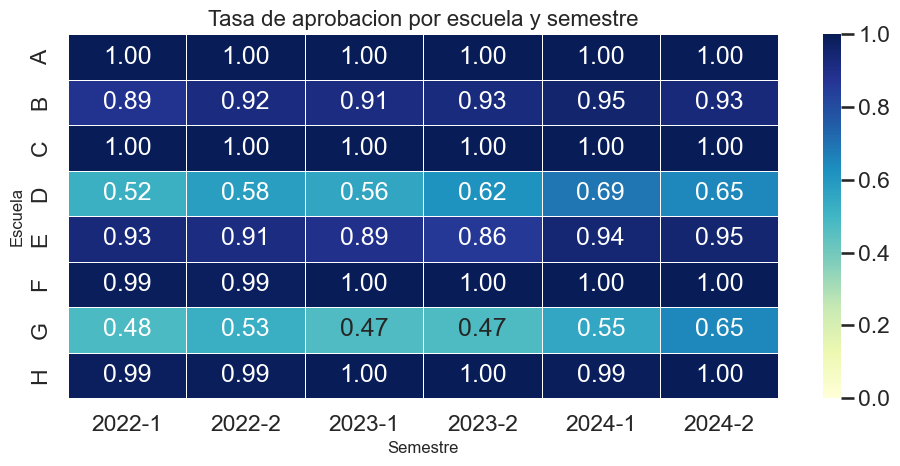
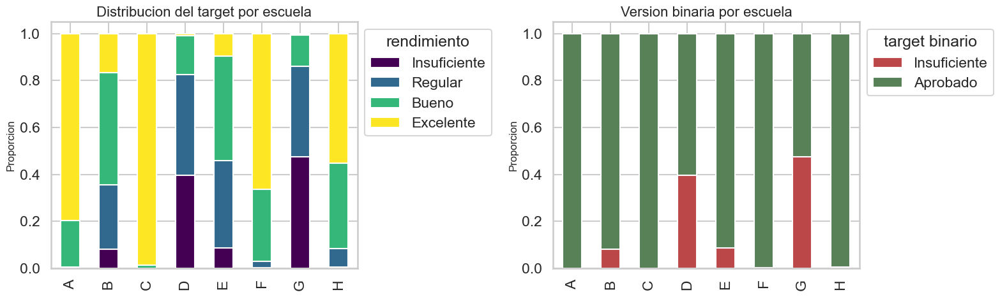
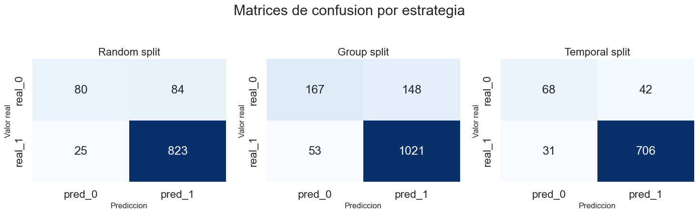

# Student Performance Classification
### Clasificación y validación por escuela con NumPy

Predecir qué estudiantes van a tener un rendimiento insuficiente parece un problema de clasificación estándar, pero tiene dos trampas: las clases están muy desbalanceadas y las escuelas son muy distintas entre sí. En este trabajo implemento los modelos desde cero y analizo cómo cambia la evaluación al tener en cuenta las dos cosas.

**Tomás González** · Machine Learning, UdeSA · 2026

[Notebook](notebook/Entrega_TP2.ipynb) · [Consigna](docs/consigna.pdf)

## Recorrido

### 1. Explorar los datos

5.058 registros de desarrollo y 795 de test, de ocho escuelas y seis semestres. La exploración mostró enseguida el problema: en algunas escuelas aprueba casi todo el mundo y en otras, cerca de la mitad.

Por eso la validación cruzada se hace **por escuela**: el modelo se evalúa sobre escuelas que no vio al entrenar.

### 2. Implementar los modelos

Con NumPy implementé regresión logística binaria y multiclase, LDA, árboles de decisión y Random Forest, junto con la búsqueda de hiperparámetros y las métricas.

### 3. Tratar el desbalance

Comparé distintas estrategias para que el modelo no ignore la clase minoritaria: ponderación de costos, undersampling, duplicación y SMOTE, siempre aplicadas dentro de cada fold de entrenamiento para no filtrar información.

### 4. Evaluar en test

| Resultado en test | Valor |
| --- | ---: |
| Accuracy binaria | 0,833 |
| F1 binario · «Aprobado» como positivo | 0,896 |
| Recall de «Insuficiente» | 0,989 |
| Accuracy multiclase | 0,692 |
| Macro F1 multiclase | 0,654 |

El modelo binario detecta 88 de los 89 casos «Insuficiente», a costa de marcar también a 132 estudiantes que aprobaron. Para un sistema de alerta temprana, ese equilibrio entre detectar y generar falsas alarmas es la decisión central.

## Abrir el trabajo

Con un entorno virtual activo:

~~~sh
python -m pip install -r requirements.txt
cd notebook
python -m jupyterlab
~~~

Se necesita NumPy 2.0 o posterior. El notebook conserva sus salidas, así que se puede leer sin reentrenar. El código está en **src/**, los datos en **data/** y las tablas de experimentos en **outputs/tables/**.

[Entorno, estructura y verificaciones](DOCUMENTACION.md)
